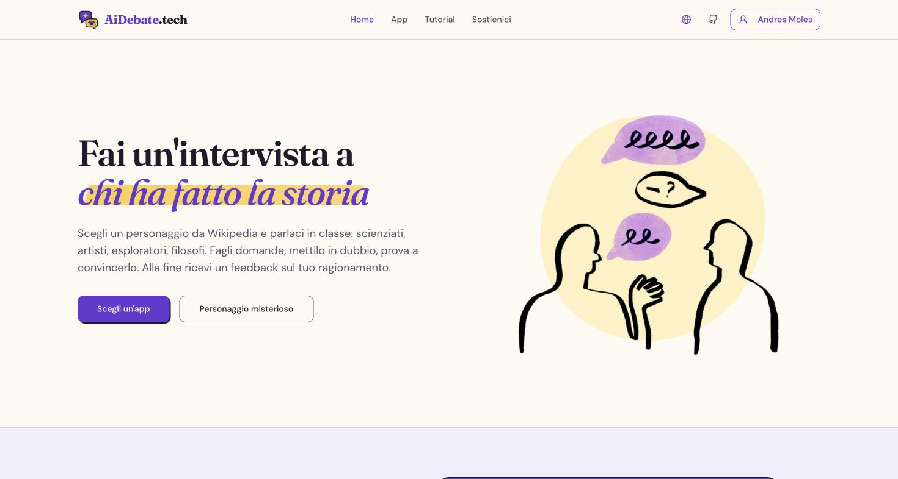
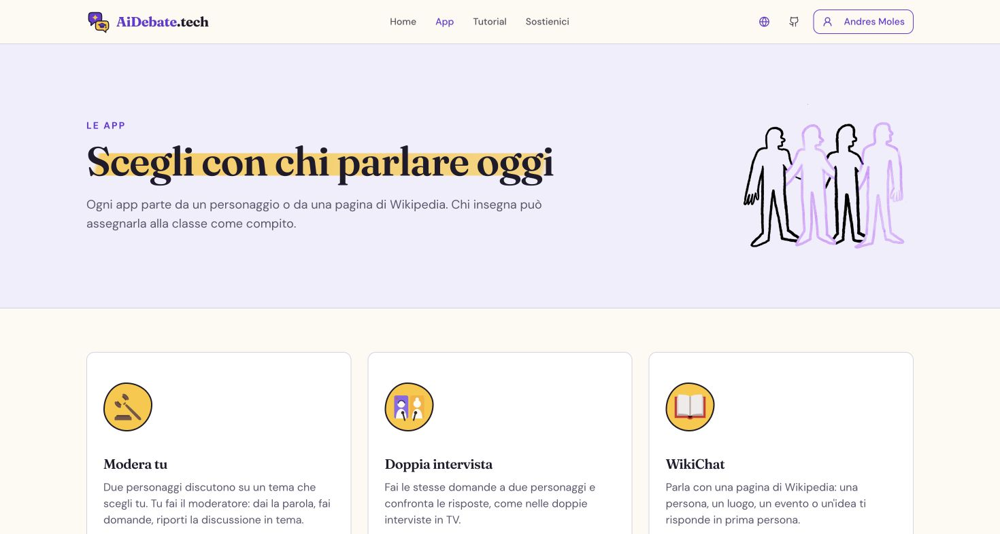
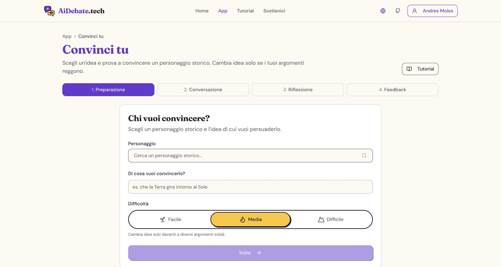
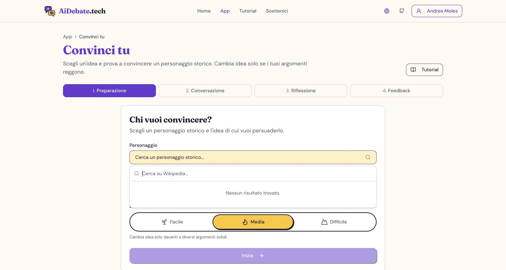
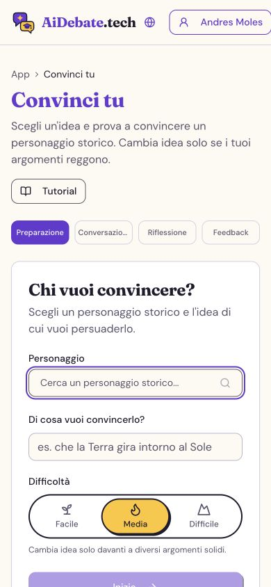

# DebateAI technical and usability review

Reviewed on 29 October 2026, against `master` at `f1d7178`. This is an assessment and implementation plan; application behavior has not been changed.

**Recommendation: keep React, Go and SQLite. Fix correctness at the session and billing boundaries, reduce unnecessary browser downloads and database round trips, then polish the existing interface. A framework rewrite or microservices would add cost without addressing the main problems found here.**

## Evidence and limits

The review covered repository instructions and architecture/deployment documentation; the six activity implementations and their shared chat, evaluation and persistence flow; authentication; AI adapters, routing, metering and judging; SQLite repositories and schema; classroom polling; representative student, teacher and administrator screens; navigation, translations, styling and CI. Generated files, binary assets and dependency source were not exhaustively audited. This is not a claim that every line or security scenario has been verified.

Local production builds and automated checks were run. A second, non-writing Vite build inspected module contributions. SQLite query plans were inspected on a fresh, isolated local database with the current schema.

The sandbox prohibits listening on local ports, including Go's `httptest` servers. Therefore screenshots come from the repository's documented deployment, `https://debateai-steel.vercel.app`, using its existing browser session. Its deployed revision was not established; visual observations are distinguished from current-source findings. No production records, AI calls, emails or settings were created or changed. Conversation, feedback, voice, teacher/admin and room flows were reviewed in source, not completed in the deployed UI. Browser screenshots alone cannot establish accessibility compliance or input latency.

| Check | Result |
|---|---|
| Production frontend build | Passed; 14.33 seconds on this machine, not a server performance measurement |
| ESLint | Passed |
| TypeScript, `tsc --noEmit -p tsconfig.app.json` | Passed with the repository's current non-strict configuration |
| Translation key check | Passed: 941 keys across five locales; does not verify translation meaning or language selection |
| Frontend tests | 201 passed, 1 failed; the same Markdown highlighting test failed when rerun alone |
| Go vet | Passed with a writable temporary build cache |
| Go tests | Main, domain and store packages passed; ai, app and httpapi suites were blocked by socket permissions, not established application failures |
| Live layout check | Desktop and 390 × 844 phone viewport; five accepted screenshots below |

## What is already good

- The Go binary and local SQLite deployment are well suited to a small server. The frontend needs no Node process in production.
- Provider keys stay server-side, stored encrypted. Authentication uses hashed session tokens and HttpOnly cookies; route and session ownership checks exist.
- The six activities share a common flow instead of duplicating a whole application each time.
- Chat history and individual messages are memoized, streaming publishes at most once per animation frame, and offscreen messages use browser layout containment. Do not redo these optimizations blindly.
- Route splitting, optional syntax highlighting, reduced-motion handling, a global error boundary and immutable caching for hashed assets already exist.
- Room creation/cleanup uses transactions, and the backend already supports a configurable judge frequency. Extend these existing owners before adding new infrastructure.

## First: protect work, assessment integrity and spending

### 1. Failed saves are hidden from the student — high priority

`src/features/activity/useActivitySession.ts:64–139` catches start, transcript and completion errors and only logs warnings. `useActivityFlow.begin` proceeds into chat even when a logged-in session could not be created. The feedback flow can display an evaluation while its completion request failed. There is no durable recovery path in the shared activity flow.

**Change:** expose explicit starting/saving/saved/failed states. For assigned work, do not silently proceed as unsaved practice. Preserve a recoverable draft with an appropriate expiry and user scope, retry safely, and confirm submission only after server acknowledgement. Provide “Retry save” and export when offline. Distinguish successful AI feedback from successfully handed-in work.

**Proof needed:** disconnect during start, transcript save and submission; reload; retry the same request; verify no loss, duplicate submission or false success.

### 2. Transcript and judge updates can overwrite newer state — high priority

`useChatEngine.ts:170–171` releases `busy` before awaiting transcript synchronization. Live callbacks also start synchronization without serializing it. `useActivitySession.ts:115` ignores older responses only in the browser. `server/internal/store/activity_sessions.go:164–190` unconditionally replaces transcripts, judgements and statuses. Two requests can load the same session state, finish judging out of order and overwrite a more recent result. A late judge can also write status after completion.

**Change:** put a monotonic revision and idempotency key on each saved turn. Accept updates conditionally, and apply a judge result only to the revision it evaluated. Enforce permitted state transitions in the database update. Serialize/coalesce client saves, but retain server protection for multiple tabs and retries. Never hold a database transaction open during an AI call.

`YouModeratePage.tsx` also lets characters continue via `speakAlone` without `afterTurn`; those lines are not saved until another sync happens. Save every completed change to the transcript, while deciding separately whether it merits a new judgement.

### 3. The browser supplies the scores and assessment evidence — high priority for assessed work

`server/internal/app/session_service.go:124–138` accepts evaluation text and scores from the owner of the session. The transcript endpoint accepts replacement messages and a client instruction to skip/force judging. The AI endpoint accepts system instructions and history from the browser. Ownership checks prevent editing another student's session, but do not establish that one's own submitted evidence or scores are authentic. Teacher-locked setup is primarily enforced in the UI.

**Change:** have the server own assignment rules, authoritative messages and final grading. A submission should carry the reflection and session revision; the server should load its evidence, generate/validate the assessment and save it. Validate score ranges even before that migration. Keep teacher scores separate. For free practice, clearly label self-reported or unverified results. The mystery character is also present in browser state: concealment is a game presentation feature, not protection against inspecting the answer.

### 4. Current limits are not a hard spending ceiling — high priority

`gateway.go:112` checks completed spending before dispatch; metering records usage afterwards. Student and room limits likewise count completed usage records. Concurrent requests can all pass a limit before any finish. `handleGenerate` passes caller-supplied `MaxTokens` through and limits history by message count rather than a meaningful token/character budget. The global 8 MB JSON cap is much larger than a classroom message needs.

Unknown prices become zero in cost calculation unless the provider returns actual cost. Budget/count repository errors can become zero too (`store/usage.go`, `store/users.go:count`). Interrupted provider streams can return no usage even after generating text. Consequently the dashboard can understate expenditure.

**Change:** enforce server-side input/output limits by task, limit concurrent generations, reserve budget before dispatch and reconcile it afterwards. Treat unknown cost as unknown, with an explicit policy for budget-controlled deployments. Propagate quota-read errors. Retain and mark estimated usage on interrupted calls. Start with transactional accounting in the existing database; Redis is not inherently necessary.

### 5. Voice usage is unauthenticated accounting input — high priority if voice is enabled

`server/internal/httpapi/ai.go:213` accepts provider/model and token counts from the caller without requiring a recorded, unconsumed live-session grant; it even ignores `sessionFor` errors. The browser reports at close using a best-effort fetch. This allows missing or fabricated usage entries, so live spending is unsuitable as an authoritative budget ledger.

**Change:** issue a server-side live-session identifier tied to the user, provider and expiry. Validate and deduplicate usage reports against it; reconcile with provider records where available and label client usage as estimated. Bound granted voice duration and reserve an allowance. Keep the direct browser-to-provider audio path unless measured requirements justify proxying audio, which adds hosting load.

### 6. Account changes do not clear user-specific browser caches — high priority on school PCs

`src/App.tsx:50` creates one query client. `AuthContext.tsx:42–51` changes the user without clearing queries. Student keys such as `['my-sessions']`, `['my-assignments']` and room keys are not scoped to the user. A subsequent user can briefly receive cached data from the previous session while a fresh request runs; data also remains cached if that request fails. AI availability has a separate cache that is not reset on authentication changes.

**Change:** cancel pending queries and remove private cached data at logout/account changes, scope user-dependent keys to identity, and invalidate AI status. Test account A → logout → account B on the same page without a full reload. Server authorization must remain in place.

### 7. Deployment topology affects protection — high priority before public scaling

`httpapi/server.go:295` trusts `X-Forwarded-For` from any request. The Docker deployment exposes the Go port directly, so clients reaching that port can choose the apparent rate-limit identity. In-memory limiters are also per-process, and provider-cache invalidation only reaches the instance handling an admin change.

**Change:** only trust forwarding headers from the configured proxy path; prevent public direct access to the upstream port when proxied. Keep a single application instance for the initial VPS deployment. If multiple instances are required, enforce admission limits transactionally and make provider configuration versioned or refreshable across instances. This is especially important when disabling a provider or rotating a key.

## Next: make the browser and backend do less work

### 8. Reduce the initial download and stop preloading every activity — high return

Measured local production chunks, rounded from Vite output:

| Chunk | JavaScript | Gzip estimate |
|---|---:|---:|
| Main entry | 1,194 kB | 398 kB |
| Shared activity flow | 380 kB | 98 kB |
| Markdown renderer | 144 kB | 45 kB |
| Administrator page | 419 kB | 114 kB |
| Optional code highlighting | 634 kB | 231 kB |

These are individual build chunks, not all initial downloads. However, `MorphGate.tsx:19–23` calls `preloadPrefix('/apps')` on every visit, including tutorial routes. The static JavaScript dependency closure of those routes includes 44 chunks and approximately 1.87 MB uncompressed in the audit build. This is a dependency calculation, not a browser network trace; caching and nested dynamic imports change actual transfers.

`i18n/index.ts` eagerly imports all five languages and tutorial namespaces. Bundle inspection attributed about 648 kB of transformed module text to translations before final minification. The activity chunk includes `@google/genai` through the live hook and `@chenglou/pretext` through the optional feedback animation, even for ordinary text chat. The main chunk also contains Sentry instrumentation; preserve useful error reporting rather than disabling it indiscriminately.

**Change in order:** load the active language plus fallback; load tutorial namespaces on their routes; import voice implementation when voice starts; lazy-load the off-by-default diffusion effect; preload only likely destinations on pointer/focus intent, with a restrained mobile/data-saving policy. Keep a retryable loading state. Restore a meaningful bundle budget instead of the current 1,600 kB warning threshold. Use Prism Light with the few languages actually required if code highlighting matters.

### 9. Batch database reads before buying a larger server — high return, especially with Turso

`assignment_service.go:188` performs one student query plus two queries per student. For 40 students, that is **81 queries per progress-service call**, excluding authentication and assignment loading. The frontend refreshes every 20 seconds: **243 service queries per minute per open foreground dashboard**. `ListForClass` uses two count queries per assignment, `ListForStudent` gets the latest session separately for each assignment, and grade export repeats progress loading. Admin user rows also fetch spend/class data individually.

**Change:** extend existing repositories with grouped queries and window functions for latest/best attempts. Keep authorization at the service boundary and preserve the existing “best attempt” ordering. Aim for a small constant query count regardless of class size. On a remote database this removes serialized network round trips; local SQLite also benefits.

### 10. Add indexes for actual access patterns — high return with growing data

Query plans from the current schema show a full scan for assignments by class, a temporary sort for latest session by user/assignment, and a user-only index for usage filtered by user and date.

Candidate indexes to validate with representative data: `assignments(class_id)`, `activity_sessions(user_id, assignment_id, started_at DESC)`, `usage_log(user_id, created_at)`, `class_members(user_id, class_id)`, and `auth_sessions(expires_at)` for cleanup. Pick additional indexes from measured queries, not every column. Include migration and write-cost checks.

SQLite WAL is already enabled. `SetMaxOpenConns(1)` serializes reads as well as writes, but changing it blindly can introduce lock contention. First remove excessive queries; only add a separate bounded read pool if measurements justify it.

### 11. Cache settings/configuration and simplify polling — medium priority

Settings are reread from SQL repeatedly while selecting routes, checking budgets and testing AI readiness. Price lookup occurs inside sort comparators. With a remote database, this can mean multiple network requests merely to choose a model.

Read a coherent settings/price snapshot for each operation; use a small versioned or short-lived cache with explicit invalidation. Do not cache a supposedly hard spending allowance without transactional reservations.

The host lobby polls every four seconds, or 900 requests per hour for an open foreground tab. Each response rebuilds guest summaries and checks AI readiness. Start with a slower interval when unchanged, immediate refresh after local actions, efficient aggregate queries and backoff for transient errors. React Query already suppresses ordinary background polling by default; do not duplicate that feature. SSE is a later option if measured classroom activity warrants its connection/hosting tradeoff.

### 12. Separate first-visible-response latency from model latency — medium priority

The model gets 25 seconds to send its first delta before fallback (`gateway.go:166`). Then `answer_check.go:110` withholds the first 160 characters, including non-chat tasks where refusal screening is not used. Very short answers remain invisible until completion. Several slow fallback targets can compound the wait. Non-streamed generation does not get this first-token decorator's timeout; the provider HTTP client has a 180-second timeout per request.

**Change:** record provider first-delta time and user-visible first-text time separately. Avoid the opening buffer for tasks that do not need that check, while preserving required content checks. Put a total deadline across fallbacks and temporarily skip repeatedly failing targets. Pick chat models by measured first-text latency and reliability as well as price; “free first” does not guarantee a responsive lesson. Do not parallelize every paid fallback, which multiplies spending.

### 13. Improve interaction without rewriting chat rendering — medium priority

The composer is disabled for the whole response (`ChatPanel.tsx:153`). Let students draft their next message while generation runs; gate sending separately. Add a real Stop action and cancel requests on restart/unmount. `generateStream` supports an `AbortSignal`, but the shared engine does not pass one; non-streaming `generate` ignores the signal option. Preserve acknowledged and partial work when cancelling.

The active assistant message still reparses the full Markdown on every published update, and evaluation parsing/rendering happens for each delta. Profile long answers on a slow device, then use a modest update cadence or incremental block rendering if needed. Existing memoization already avoids rerendering the entire history on each keystroke.

Navigation intentionally waits for route preloading, up to 1.5 seconds, before changing the page. Use intent prefetch and immediate navigation feedback; an animation should not look like an ignored click. Live microphone processing uses a 4,096-sample `ScriptProcessor` buffer at 16 kHz, a nominal 256 ms capture block before network/model time. If voice is a priority, test AudioWorklet and a smaller supported block; this is not a measured end-to-end latency figure.

### 14. Reduce repeated AI work with existing controls — medium priority

JEV defaults to checking every student turn. For a one-character, 12-turn assigned conversation with goals, that normally means 12 response calls plus 12 judgement calls, before introduction/final feedback or retries. `EvaluateEvery = 3` would make four scheduled checks instead of twelve, a 67% reduction in those checks, but goal completion could be detected up to two turns later. Preserve checks at the final allowed turn and explicit final-guess events. The benefit applies only where checking every turn is unnecessary. CHECK ONLY IN "PERSONAGGIO MISTERIOSO" if the student write the name of the character the game ends after the answer of the ai ("excalty i am...congratulation bla bla"), for this revise the pormpt and let jev had the power to stop the game. 

Deduplicate judgement for an unchanged transcript revision. Apply a token-aware history window for generation while retaining the full transcript for the teacher. Measure accuracy before truncating context or adding summaries. Two independent interview answers could eventually run concurrently against frozen histories, but moderated debate answers depend on prior turns and should remain ordered.

### 15. Keep mail delivery bounded and recoverable — medium priority

`mail.go:209` starts a goroutine per notification with no durable queue; SMTP has a dial timeout but no whole-exchange deadline. A large class or stalled SMTP server can consume connections and lose notifications when the process exits. Serverless instance termination makes this more significant.

Use a small database outbox and bounded delivery worker, with deadlines, retry status and shutdown handling. Reuse the current mailer. A separate message broker is unnecessary at this size.

## UI and usability: preserve the identity, improve task completion

The warm background, purple actions, serif headings and illustrations already look deliberate. A professional school product also needs dependable save/error states, easy navigation and clear next actions.

### Captured flow

1. **Homepage — visually healthy; task entry could be clearer.** Strong hierarchy and readable copy. The primary action is clear, but returning teachers/students could reach their dashboard or classroom task more directly. Preserve the character rather than replacing it with a generic dashboard aesthetic.

2. **Activity selection — usable, but too much vertical space before actions.** At the captured 1470 × 786 viewport, the first row's launch actions are below the fold. Reduce the internal-page hero and card artwork spacing. Move the unreleased activity out of the middle of available choices. Add concise guidance such as skill practiced, typical duration and number of speakers. Use real links with specific accessible names such as “Start Double Interview”, supporting opening in another tab.

3. **Activity setup — clear basic structure; help users get started.** The shared four-stage flow is a strength. Add a small set of curated character/topic examples and an explanation of what remains before Start is available. Make required fields explicit. Current-source setup buttons do not consistently represent the pending session-creation request; prevent duplicate starts and communicate that wait. Failed assignment loading currently leaves generic setup available: block assigned submission until its rules load, or explicitly offer a separate free-practice mode.

4. **Character search — misleading initial state.** The empty search immediately says “Nessun risultato trovato” before a query exists. Show “Type a name to search” initially, a real loading state during requests, “No matches” only after a successful search, and a retryable network-error state on failure.

5. **Phone setup — navigation defect.** At 390 px width, the account button extends to x=391 and the menu spans x=395–435, outside the visible viewport. The form itself fits, but the four-stage label truncates “Conversazione”. Make the account control icon-only or substantially narrower below the small breakpoint, preserve a reachable menu, and show “Step 1 of 4: Preparation” with compact progress on narrow screens. Check long account names, translated labels and 200% zoom.

### Additional source-confirmed usability problems

**Search races and language mismatch.** `WikiSearchSelect.tsx` debounces for 500 ms but does not cancel or reject stale responses, retains old results when the input becomes empty, and applies cmdk's local filtering on top of Wikipedia results. Its language map handles `en` but falls back to Italian for `en-US`; other helpers normalize to two letters. Use one locale helper, abort superseded requests, clear on empty input, and disable local filtering for authoritative remote results. `useWikiSummaries` also needs language in its effect identity; cached summary length should not depend on whichever `maxChars` request happened first.

**Errors are mistaken for empty or closed states.** The student dashboard treats failed assignments/history queries like empty lists. AdminCosts can show an endless spinner when the initial summary fails. HostRoomPage treats any error as a closed room, while `useRoomView` stops polling after that error. Preserve existing data, display “Connection lost—retrying”, offer Retry, and reserve “Room closed” for a confirmed closed/expired response. Password-reset UI likewise swallows transport failures: retain anti-enumeration behavior while acknowledging inability to contact the server.

**Resume is missing from the shared activity flow.** Refreshing loses local phase/messages and the dashboard offers retry/view rather than a true continuation. Add an explicit resumable active session route with server hydration, plus a narrowly scoped draft for unsent text. Restart should clearly distinguish a new attempt from continuing one.

**Status and score semantics disagree.** GuestRoomPage treats `turn_limit` as done, while StudentDashboard treats it as unfinished; `goal_reached` can appear finished before reflection is handed in. Progress uses different latest/best attempt choices across views. Define “conversation ended”, “submission pending”, “submitted” and “reviewed” centrally, and label whether a displayed score is AI feedback or a teacher grade. Preserve intentional best-versus-latest differences, but explain them.

**Accessibility needs a targeted pass.** The document stays `lang="it"` while the UI supports five languages. Some icon-only links lack names; generic repeated “Start” buttons need context. Pale `text-amber-300/400` and `text-sky-300` remain on light surfaces in badges, warnings and speaker selectors, contrary to the design system's darker-text guidance. Replace these with tested semantic text tokens. Check actual computed contrast, keyboard focus, streamed chat announcements and IME Enter handling; the chat's key handler currently does not check composition state. This review does not certify WCAG conformance.

**Documentation and product copy drift.** WikiChat's tutorial card says it is coming soon because it checks teacher slides, even though its student tutorial route exists. DESIGN_SYSTEM.md simultaneously specifies no glass/gradients and later recommends blur/transparency and obsolete component names. The homepage self-hosting copy implies chats are not saved elsewhere, although configured external AI providers receive conversation content. Distinguish local storage from external processing, and list the actual configured data path. Correct the tutorial capability check and document the real shared components/tokens.

## Cheapest sensible deployment

For a modest school deployment, start by evaluating **one Go instance with local SQLite on SSD, behind a TLS reverse proxy**, serving the built frontend from the same origin. Build the Docker image/binary in CI, not on the small host. Use external AI inference if inexpensive web hosting is the objective; local LLM inference has very different RAM/compute requirements.

| Option | Best fit | Tradeoff |
|---|---|---|
| Small VPS + Go + local SQLite | Predictable school workload and lowest architectural complexity | You own patching, backups and availability; one failure domain |
| Existing Vercel + Turso | Managed deployment and elasticity | Remote-query latency, invocation/runtime costs and multiple-instance accounting must be addressed |
| Larger machine or distributed services | Only after measured capacity limits | Higher bill and operational complexity; does not fix avoidable queries or lost saves |

A 1-vCPU/1-GB instance is a **benchmark candidate**, not a promised capacity. A 2-GB instance provides more headroom. Actual suitability depends on concurrent students, transcript size, exports, TLS/proxy overhead and provider delays. No current vendor prices or production traffic measurements were available, so there is no defensible monthly-cost or supported-user guarantee here.

For self-hosting, enable Brotli/gzip for static text assets at the proxy or precompress during the build. Hashed asset caching is already present; keep HTML revalidated and exclude streamed AI responses from buffering. Back up the database and encryption secret consistently, test restoration, and monitor disk growth. Do not enable relaxed SQLite durability settings merely to win a benchmark.

For the current managed deployment, batch queries and place compute/database close together before changing vendors. Verify SSE through the actual hosting path: the repository explicitly leaves that check open. Version migrations rather than rerunning every historical ALTER statement on each fresh process startup. Verify foreign-key behavior against the remote backend, including user/class deletion paths, rather than assuming local PRAGMAs apply remotely.

## Proposed implementation order and acceptance criteria

| Pass | Work | Evidence of completion |
|---|---|---|
| 1. Correctness | Visible save failures, revisioned transcript/judgement updates, server-owned assessment, private cache isolation, budget/admission and voice accounting | Offline/retry recovery; out-of-order saves cannot regress data; forged scores rejected; no cross-user cached content; concurrent calls respect reservations |
| 2. Cost and responsiveness | Lazy language/optional features, restrained prefetch, batched SQL, measured indexes, configuration snapshot, cancellation and first-text metrics | Smaller route transfer/parse cost; bounded query count; no orphan generation after restart; separate provider and visible-first-text timings |
| 3. Classroom polish | Phone header, compact app selection, useful search states/examples, resumable work, explicit submission states and accessible tokens | Keyboard and phone walkthroughs, five locales, slow/offline network, long names and 200% zoom |
| 4. Hosting validation | Representative 30–40 student lesson, then larger concurrent workloads on candidate VPS and current managed deployment | CPU/RSS, SQLite wait time, p50/p95 API latency, errors, AI tokens/cost and recovery measured; a real backup restored |

Keep ordinary UI interactions under the Core Web Vitals “good” INP threshold of 200 ms at the 75th percentile and aim for LCP under 2.5 seconds on representative devices. These are acceptance targets, not measured results of this review. For backend load tests, use a local fake streaming provider to isolate application overhead, then a small controlled real-provider sample to measure AI latency separately.

The failing frontend test expects a separate syntax-highlight token `42`, even though the plain-code fallback already contains `const answer = 42;`. It failed twice here; investigate optional module loading and test the readable-code contract separately from highlighting. Do not interpret it as proof that all code rendering is broken. Add TypeScript checking and a focused browser smoke path to CI; introduce stricter typing incrementally at API boundaries. Avoid broad refactoring solely to satisfy abstract patterns.

**The first implementation should make session saving and assessment state reliable. The next largest economic wins are fewer SQL round trips and loading only the browser code needed for the current task.**
